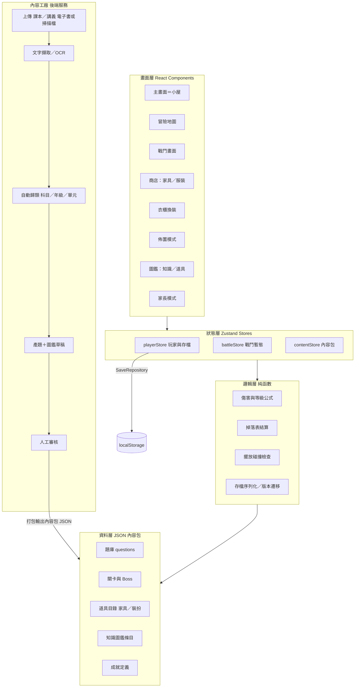

# 遊戲化學習冒險遊戲 — 開發架構文件

> 用途：本文件供 Codex 直接依階段開工。每個 Phase 附驗收標準，驗收通過才進下一階段。
> **2026-10-24 使用者追加需求：遊戲與戰鬥畫面必須以 3D 呈現。** 場景層改採 Three.js + React Three Fiber（React 18 搭配 Fiber 8），小屋、地圖、角色、Boss 與家具使用 3D 網格、相機、光照及陰影；題目與功能面板保留 React DOM。此需求優先於下文 DOM 靜態場景、SVG 佔位與 PNG 角色分層的原始呈現選型；Phase 3 改為 3D 地板格子擺放，Phase 4 改為對應 slot 的 3D 部件換裝，其餘內容包、外觀不影響戰鬥及階段順序維持不變。
> 參考原型：Facebook「邏輯投資」分享之《龍埔自然大冒險》（平板截圖 4 張，2026-10-21 貼文）。
> **本版關鍵改版**：獎勵系統由原型的「裝備升攻防」改為**收藏向**——獎勵為兩類外觀道具：**室內佈置道具（家具）**與**人物裝扮道具**，不影響戰鬥數值；戰鬥強度改由「冒險等級」驅動。
> **內容來源改版**：學習內容不靠人工編題——家長上傳課本／講義電子檔（電子書 PDF／EPUB 或掃描檔），「內容工廠」自動擷取文字、**自動歸類科目與年級**、產題與圖鑑草稿，經人工審核後打包成內容包供遊戲載入（§6.8）。
> **2026-10-26 使用者選擇 CF-A 先採本機版，教材保留在本機，並要求測試完成後保留教材檔案。** 預設使用 Tesseract 與明示規則歸類，Azure OCR／語言模型介面保留但不預設啟用；缺乏課程或單元依據時交由家長確認。所有 OCR 結果也需對照確認。測試素材及紀錄保留在 `.local/`，不提交 GitHub。操作說明見 `docs/CONTENT-FACTORY.md`。

---

> **2026-10-26 追加需求：題型包含選擇題與填空題，教材及產題支援台灣國小至國中（1–9 年級）。** CF-B 同時支援四選一與填空；題量與難度依下列動態題量修訂，選項分佈僅計選擇題。填空題以一個 `___` 及明列 `acceptedAnswers` 評分，支援全半形／英文大小寫／前後空白正規化，其他等價答案須人工明列。來源、解析及人工核准條件與選擇題一致；遊戲戰鬥、錯題複習皆支援，3D 場景維持。既有高中歸類欄位保留，但目前不開放高中產題。

> **2026-10-26 題量修訂：各單元題庫依教材內容量與複雜度決定，不固定題數。** 以去重候選知識點與因果／比較、實驗／程序、公式／計算訊號規劃不同考法，產題前顯示依據；來源不足明列略過，不硬湊。每次挑戰從該單元題庫隨機抽最多十題，通常混入約三成錯題，普通題不足才補其餘錯題；同場不重複。短題庫按實際題數並比例調整 Boss 生命。題量規則及例子見 `docs/QUESTION-DRAFTS.md`。

## 1. 專案概述

- **產品**：國小至國中學科複習遊戲化 Web App，平板優先（橫向），可安裝為 PWA 離線遊玩。
- **核心循環**：選關卡 → 答題打 Boss → 得金幣＋掉落道具 → 商店買家具／裝扮 → 佈置小屋、幫角色換裝 → 解鎖下一關與知識圖鑑。
- **設計原則**：
  1. **內容與程式分離**：題庫、關卡、道具、圖鑑全是 JSON 內容包。內容包主要由「內容工廠」產生（上傳教材→自動歸類→產題→審核→打包，見 §6.8）；換科目／年級＝換內容包，不改程式（日後可擴充國中數學等）。
  2. **獎勵全外觀**：家具與裝扮不帶任何戰鬥數值；小孩的成就感來自「收集與佈置」，不是數值輾壓。
  3. **單機本機存檔**：MVP 無後端、無帳號、無廣告、無內購。
  4. **答錯不懲罰到底**：答錯進錯題池，可在複習模式重練；戰鬥失敗不掉道具、金幣不倒扣。

## 2. 原型還原盤點（截圖可確認的部分）

| 原型畫面 | 內容 | 本版對應 |
|---|---|---|
| 冒險戰鬥 | Boss「風暴魔王」＋四選一題目（例：溫度計應放通風陰涼處） | §6.1 戰鬥系統（保留） |
| 裝備鐵匠鋪 | 劍（ATK）／盾（DEF）／項鍊（HP）升級、買 HP 藥水 | **改版**：戰鬥數值改由冒險等級決定；商店改賣家具與裝扮；藥水保留為消耗品 |
| 溫馨小屋 | 買家具（木書桌、沙發、觀察箱、電視、床、獎盃）累積舒適點數 | §6.3 佈置系統（擴充為可自由擺放的格子編輯器＋收藏率） |
| 自然知識圖鑑 | 小三自然五單元：植物構造與功能、動物分類、天氣觀測、力與磁鐵、溶解與水的三態 | §6.5 圖鑑系統（知識圖鑑＋新增道具圖鑑） |

> 註：原型如何開發、用什麼工具，公開管道查無資訊；以上以截圖可見之設計為準。

## 3. 技術選型

| 項目 | 選型 | 理由 |
|---|---|---|
| 平台 | Web App（PWA），平板橫向優先，相容手機／桌面 | 一次開發多裝置；可離線；免上架 |
| 框架 | Vite + React 18 + TypeScript | 元件化適合大量面板 UI（商店、衣櫃、圖鑑）；Codex 產出穩定 |
| 狀態管理 | Zustand | 輕量；遊戲狀態與存檔集中管理 |
| 樣式 | Tailwind CSS | 快速排版；大按鈕、大字體（兒童 UI） |
| 存檔 | localStorage（MVP）→ 介面預留 IndexedDB（idb-keyval） | 先簡單；存檔層抽象成 `SaveRepository` 方便日後替換 |
| 動畫 | CSS transition + Framer Motion（戰鬥打擊感、掉落演出） | DOM 遊戲不需 Canvas 引擎 |
| 音效 | Howler.js + 免費音效包（答對／答錯／金幣／購買） | 可全域靜音 |
| 後端（內容工廠） | ASP.NET Core 8 ＋ 背景 Worker | 與團隊技術棧一致；上傳、擷取、OCR、LLM 呼叫、打包皆在後端，遊戲端維持純前端離線 |
| OCR | Azure AI Document Intelligence（預設）／ Tesseract（備援），介面 `IOcrProvider` | 繁中掃描件辨識精度優先；供應商可替換 |
| LLM | 介面化 `ILlmProvider`（OpenAI／Claude 任一） | 自動歸類、產題、圖鑑草稿；換供應商不改流程 |
| 測試 | Vitest（遊戲邏輯單元測試）＋ Playwright（主循環 smoke test） | 戰鬥與掉落為純函數，必須可測 |
| 美術 | MVP：SVG 圖示＋色塊佔位；正式：AI 生成 PNG（人物裝扮採**分層圖**，見 §6.4） | 先跑通循環，美術後換 |

**不用** Phaser／Canvas 引擎：本作畫面以 UI 面板與靜態場景為主，DOM 開發與維護成本最低。

## 4. 系統架構



目錄結構（建議）：

```
src/
  app/            # 路由與畫面（home, map, battle, shop, wardrobe, decor, dex, parent）
  components/     # 共用 UI（AvatarRenderer, ItemCard, CoinBadge...）
  stores/         # playerStore, battleStore, contentStore
  logic/          # battle.ts, drops.ts, placement.ts, save.ts, achievements.ts
  data/           # 內容包載入與型別（schemas.ts, loader.ts）
  assets/         # 圖片與音效
content-packs/
  science-g3/     # 內建內容包：國小三年級自然
    pack.json     # 科目、年級、單元清單
    questions.json
    units.json
    items.json
    drops.json    # 各單元 common／rare／epic 掉落池，載入時驗證引用
    outfit-models.json # 3D 裝扮樣式、顏色、部位與錨點
    encyclopedia.json
    achievements.json
```

## 5. 資料模型

### 5.1 題目 Question

```ts
interface Question {
  id: string;              // "sci-g3-u3-q01"
  unitId: string;
  stem: string;            // 題幹
  type?: 'choice' | 'fillBlank'; // 省略時沿用四選一
  options: string[];       // choice 必須四項；填空可省略，載入為 []
  answerIndex: number;     // choice 的 0–3；填空不使用，預設 0
  acceptedAnswers?: string[]; // 填空必填，1–8 個明列答案，第一個為參考答案
  explanation: string;     // 答後解析（教學關鍵，必填）
  difficulty: 1 | 2 | 3;
  zhuyin?: string;         // 逐漢字注音，以空白分隔，不含標點；由 ruby 呈現
}
```

### 5.2 關卡 Unit 與 Boss

```ts
interface Unit {
  id: string;
  name: string;            // "天氣觀測"
  order: number;
  boss: { name: string;   // "風暴魔王"
          asset: string;  // 圖片路徑
          hp: number;     // Boss 血量（題數約 8–12 題打完）
          attack: number; // 答錯時對玩家傷害基準
        };
  questionPool: string[];  // Question id 清單
  encyclopediaIds: string[];
  dropTableId: string;
  unlockAfter?: string;    // 前一關 Unit id，線性解鎖
}
```

### 5.3 道具 CosmeticItem（本版核心）

```ts
type ItemKind = 'furniture' | 'outfit';
type OutfitSlot = 'hair' | 'top' | 'bottom' | 'shoes' | 'hat' | 'accessory' | 'handheld';
type Rarity = 'common' | 'rare' | 'epic';

interface CosmeticItem {
  id: string;
  kind: ItemKind;
  name: string;            // "木書桌"、"探險帽"
  rarity: Rarity;
  price: number;           // 商店售價（金幣）；0 = 不可購買（掉落／成就限定）
  asset: string;           // 圖片路徑
  obtainFrom: Array<'shop' | 'drop' | 'achievement' | 'starter'>;
  // 家具專用
  slot?: never;
  gridW?: number;          // 佔格寬
  gridH?: number;          // 佔格高
  layer?: number;          // 室內 z 序（地毯 < 桌 < 桌上物）
  // 裝扮專用
  outfitSlot?: OutfitSlot; // layer 順序由 slot 固定對照表決定
}
```

稀有度與定價帶（寫入 `gameConfig`，可調）：common 30–80 金幣、rare 120–250、epic 400–800（epic 以掉落／成就為主、商店少量）。

### 5.4 玩家存檔 PlayerSave

```ts
interface PlayerSave {
  saveVersion: number;
  coins: number;
  xp: number;                       // 冒險等級由 xp 推導（見 §6.1）
  ownedItemIds: string[];           // 已擁有道具（家具含數量見 inventory）
  inventory: Record<string, number>;// itemId -> 數量（家具可重複持有；裝扮恆為 1）
  equippedOutfit: Partial<Record<OutfitSlot, string>>; // slot -> itemId
  roomLayout: PlacedFurniture[];    // 小屋擺放狀態
  clearedUnitIds: string[];
  readEncyclopediaIds: string[];
  wrongQuestionIds: string[];       // 錯題池
  unlockedAchievementIds: string[];
  stats: { battlesWon: number; questionsAnswered: number; correct: number };
  updatedAt: string;                // ISO 時間
}

interface PlacedFurniture {
  itemId: string;
  x: number; y: number;             // 格子座標
  rotation: 0 | 1;                  // 0=正面 1=側面（MVP 可只支援 0，欄位先留）
}
```

### 5.5 內容工廠資料模型

```ts
interface SourceDocument {
  id: string;
  fileName: string;
  fileType: 'pdf-text' | 'pdf-scan' | 'epub' | 'image';
  pageCount: number;
  uploadedAt: string;
  status: 'uploaded' | 'extracting' | 'classifying' | 'generating' | 'reviewing' | 'packed' | 'failed';
}

interface ClassificationResult {
  stage: '國小' | '國中' | '高中';
  grade: number;            // 國小 1–6、國中 7–9、高中 10–12
  subject: string;          // 自然、數學、國語、社會、英語、理化、生物…
  publisher?: string;       // 翰林／康軒／南一（可辨識時）
  unitGuess: Array<{ title: string; pageRange: [number, number]; confidence: number }>;
  confidence: number;       // 0–1；< 0.7 必須人工確認才可繼續
  confirmedByUser: boolean;
}

interface GeneratedQuestion extends Question {
  reviewStatus: 'draft' | 'approved' | 'rejected';
  sourceRef: { documentId: string; page: number };  // 出處頁碼，審核可回查原文
}
```

## 6. 核心系統設計

### 6.1 戰鬥系統

- 回合制：一題一回合。答對 → 攻擊 Boss；答錯 → Boss 反擊並顯示解析，題目進錯題池。
- **玩家數值只由冒險等級決定**（不吃裝備）：
  - `playerMaxHp = 100 + (level - 1) * 10`
  - `damagePerHit = 18 + (level - 1) * 2`，±15% 隨機浮動，10% 爆擊 ×1.5
  - `level = floor(sqrt(xp / 100)) + 1`（xp 來源：答對 +10、通關 +50）
  - Boss 反擊傷害 = `boss.attack − level * 1`，最低 5
- 消耗品：HP 藥水（商店購買，戰鬥中可用，回 50 HP），保留原型的藥水迴圈，但歸類為消耗品而非獎勵。
- 失敗：HP 歸零 → 回地圖，HP 回滿，不扣任何已得獎勵（該場未結算的金幣不發）。
- 每場題數：自題池抽 10 題不重複；優先混入該單元錯題（若有）最多 3 題。

### 6.2 獎勵結算（改版核心）

通關結算畫面依序演出：金幣 → 經驗 → 掉落道具開箱。

- **金幣**：基礎 50 ＋ 每答對 1 題 5 ＋ 全對獎勵 30 ＋ 首次通關獎勵 100。
- **掉落**：每關一張掉落表，通關必掉 1 件、25% 機率加掉 1 件；權重 common 70%／rare 25%／epic 5%（epic 僅限該關限定款，製造回訪動機）。
- **重複轉換**：掉到已擁有的裝扮 → 自動轉 30 金幣並顯示「重複，換成金幣」；家具可重複持有（佈置需要多張椅子），上限 9 件。未滿上限不轉換；已滿 9 件後再掉落則轉為 30 金幣，結算顯示「家具已滿 9 件，換成金幣」，避免獎勵遺失。
- **成就獎勵**：特定成就（如「答對 100 題」「佈置 10 件家具」）給限定道具（如原型的獎盃家具），`obtainFrom: ['achievement']`、商店不賣。

### 6.3 室內佈置系統

- 小屋即主畫面：玩家角色站在屋裡，進遊戲先看到自己的佈置成果（情感連結最強的位置）。
- 佈置模式：從「家具箱」拖曳家具到房間格子（建議 12×8 格），碰撞檢查（不可重疊、不可超出界），可移動、收回；桌上物 layer 較高者可疊放於桌面格（MVP 先做同層不重疊，疊放列 Phase 3 進階項）。
- 觸控優先：拖曳需支援 touch 事件，格子吸附，拖曳時顯示可放（綠）／不可放（紅）提示。
- **收藏率**：畫面顯示「家具收藏 x/y」、依已擺放件數與收藏率給佈置稱號（如「溫馨新手」→「佈置大師」），取代原型的舒適點數數值。
- 預設贈送 starter 家具組（床、書桌、椅子、地毯）確保第一天就有東西可擺。

### 6.4 人物裝扮系統

- 依使用者 3D 要求，角色採**3D 部件合成**：髮型、上衣、下身、鞋子、帽子、配件、手持物七部位，每個 slot 一次裝一件；各部件對齊共用角色座標系的固定錨點，遮擋由 3D 深度處理。`outfit-models.json` 定義模型樣式、配色、錨點；`AvatarRenderer` 統一組裝。資產規範見 `docs/OUTFIT-ASSETS.md`，以幾何範圍與錨點檢查取代原 PNG 512×768 畫布規格。
- 衣櫃畫面：左側即時預覽角色，右側依 slot 分頁列出已擁有裝扮，點選即換裝並自動存檔。
- 商店服裝區：購買前可**試穿預覽**（在預覽角色上顯示，未購買也能看效果），降低小孩買錯的挫折。
- 角色會穿著當前裝扮出現在：小屋主畫面、戰鬥畫面（左側）、結算畫面——讓裝扮「被看見」是收集動機的關鍵。

### 6.5 圖鑑系統

- **知識圖鑑**：每單元 2–3 條，通關該單元後解鎖；條目含標題、插圖、一小段說明（例：天氣觀測——溫度計要放在通風陰涼處）。已讀打勾，鼓勵複習。
- **道具圖鑑**：全部家具／裝扮的收集圖鑑，已擁有顯示彩圖，未擁有顯示剪影＋取得方式提示（商店／某關掉落／成就），驅動收集目標。

### 6.6 錯題複習模式

- 地圖上獨立入口「複習小徑」：從錯題池出題，無 Boss、無失敗，答對一題移除錯題並給 2 金幣（低額，避免刷金幣）。
- 錯題池為空時顯示鼓勵訊息。

### 6.7 成就系統

- 定義於 `achievements.json`：條件（計數型：答對題數、通關數、收藏數、佈置數）→ 獎勵（限定道具或金幣）。
- 結算與佈置／換裝動作後檢查觸發，跳出成就通知並發獎。

### 6.8 內容產生管線（內容工廠）

學習內容的唯一入口。家長在內容工廠上傳教材，系統依序處理：

1. **上傳**：支援電子書 PDF（有文字層）、掃描版 PDF、圖片（jpg/png 逐頁）、EPUB。驗證格式與大小（≤ 200MB），建立 `SourceDocument` 並排入背景工作佇列，狀態即時回報前端。
2. **文字擷取**：
   - 有文字層的 PDF／EPUB → 直接抽取文字，保留標題層級與頁碼。
   - 掃描檔／圖片 → 走 `IOcrProvider`（預設 Azure AI Document Intelligence，繁中）逐頁辨識，輸出同格式（每頁文字＋頁碼）。
3. **結構切分**：依章節標題切成 chunks；無標題時以目錄頁頁碼範圍切分；再不行以固定頁窗切分並標記低信心。**封面頁與目錄頁為歸類關鍵頁，擷取失敗時擋下並提示重傳該頁。**
4. **自動歸類**：`ILlmProvider` 分類器讀封面、目錄與抽樣內頁，輸出 `ClassificationResult`：
   - 學制與年級：國小 1–6／國中 7–9／高中 10–12；科目依 108 課綱科目表。
   - 同步把 chunks 對應到單元候選（單元名＋頁碼範圍）。
   - `confidence < 0.7` 或單元對應不明確 → 進審核介面以**下拉選單讓家長確認／更正**（學制、年級、科目、出版社），確認後才往下產題；更正結果寫回 `pack.json` 作為內容包詮釋資料。
5. **內容生成**（逐單元）：
   - 知識點摘要 → 知識圖鑑條目草稿（標題、說明、出處頁）。
   - 混合題型草稿：每單元依候選知識點及複雜度動態規劃選擇與填空題量；生成約束寫死於 prompt 模板——四個選項長度相近、干擾項取自該單元常見錯誤概念、必附 `explanation`、必附 `sourceRef` 頁碼、難度依理解、應用及推論考法配置，不固定配比。
   - 答案分佈自動檢查：同一單元正確選項位置占比須落在 15%–35%，不符自動重生該題。
6. **人工審核（強制關卡）**：審核介面依單元列出題目與圖鑑草稿，可逐題核准／編輯／重生／退回，並能一鍵跳到出處頁原文對照。**未核准的內容不得進內容包**；本批有來源支持的實際題目全數核准，才可打包；來源不足略過者保留原因。
7. **打包與匯入**：打包器輸出符合 §5 格式的內容包目錄（`pack.json` 含科目、年級、來源文件 id、版本號），並跑格式驗證（欄位、id 唯一、題池引用完整）。遊戲端於家長模式匯入或切換內容包即可遊玩，不需重新部署。

> 版權原則：上傳之課本／講義僅供自家學習使用；產出的內容包綁定來源文件、僅供個人使用，不對外散布、不上架。

## 7. 畫面清單與流程

1. **主畫面（小屋）**：角色＋家具呈現；入口按鈕：冒險地圖、商店、衣櫃、佈置、圖鑑、家長模式（家長模式需長按＋簡單算術驗證，避免小孩誤入）。
2. **冒險地圖**：單元節點線性排列，已通關打星，未解鎖上鎖。
3. **戰鬥畫面**：Boss 圖與血條、角色（當前裝扮）與血條、題目卡（題幹＋四選項大按鈕）、藥水按鈕、答後解析彈窗。
4. **結算畫面**：金幣／經驗動畫、掉落開箱、成就通知。
5. **商店**：分頁「家具」「服裝」「藥水」；金幣餘額常駐；試穿／預覽。
6. **衣櫃**：分 slot 換裝。
7. **佈置模式**：家具箱＋格子房間拖放。
8. **圖鑑**：知識／道具兩分頁。
9. **家長模式**：學習報表（答題數、正確率、錯題清單）、存檔備份／還原、重置進度；**內容工廠**：上傳課本／講義、確認自動歸類結果（學制／年級／科目）、審核產出題目與圖鑑草稿、打包與匯入內容包、內容包切換。

## 8. 內容包規範（內建：國小三年級自然）

五單元比照原型圖鑑主題，每單元：1 名 Boss、題池 ≥ 12 題、知識圖鑑 2–3 條、專屬掉落表（至少 1 件該單元主題 epic 家具或裝扮，如天氣單元掉「彩虹窗簾」、力與磁鐵單元掉「磁鐵造型帽」）：

1. 植物構造與功能
2. 動物分類
3. 天氣觀測（Boss：風暴魔王）
4. 力與磁鐵
5. 溶解與水的三態

種子題目由開發時先行撰寫示例（每單元先 5 題跑通流程，Phase 5 補滿 12 題）；本內建包定位為展示與測試用，實際使用內容由內容工廠自課本／講義產生（§6.8）；題目格式嚴格依 §5.1，`explanation` 必填。

## 9. 存檔與資料安全

- 每次狀態變更後 debounce 500ms 自動存檔；`saveVersion` 寫入存檔，載入時跑遷移函數（MVP 先留空遷移表與版本檢查）。
- 家長模式提供匯出／匯入 JSON（換裝置、備份）。
- 存檔損毀時：保留損毀檔備份 key，回到新遊戲流程並提示家長。

## 10. 開發階段與驗收標準

### Phase 0 — 骨架與資料層
- Vite+React+TS 專案、Tailwind、Zustand；`schemas.ts` 型別與內容包載入器（含 JSON 格式驗證，錯誤訊息指出哪個檔案哪一筆）。
- `SaveRepository`（localStorage 實作）、新遊戲初始化（含 starter 家具組）。
- ✅ 驗收：`npm run dev` 可開主畫面（小屋空場景＋角色佔位圖）；載入 science-g3 內容包並在 console 列出單元數；重新整理後存檔仍在。

### Phase 1 — 戰鬥核心循環（MVP）
- 冒險地圖（線性解鎖）、戰鬥畫面、§6.1 全部公式、解析彈窗、勝敗結算（先只發金幣與 xp）。
- ✅ 驗收：可從地圖打完第 1 關並回到地圖，星等與金幣正確入帳；答錯顯示解析且題目進錯題池；Vitest 覆蓋傷害／等級公式與抽題不重複。

### Phase 2 — 獎勵與商店
- §6.2 掉落結算與開箱演出、重複轉換；商店三目分頁、購買流程、藥水購買與戰鬥中使用。
- ✅ 驗收：通關必掉 1 件且入庫存；金幣不足不可購買且有提示；掉落權重以 1,000 次模擬測試驗證分佈（common 70%±3%）。

### Phase 3 — 室內佈置
- 佈置模式拖放（滑鼠＋觸控）、碰撞檢查、收回／移動、收藏率與稱號；小屋主畫面渲染 layout＋角色。
- ✅ 驗收：平板觸控可完成擺放一張桌子並存檔，重開 App 位置不變；重疊與出界被拒絕且有紅框提示。

### Phase 4 — 人物裝扮
- AvatarRenderer 3D 部件合成、衣櫃換裝、商店試穿預覽；角色裝扮同步出現在小屋／戰鬥／結算三處。試穿不扣款、不入庫、不寫入正式穿搭。
- ✅ 驗收：換裝後三個畫面顯示一致；每個 slot 至多一件；`npm run check:assets` 的模型樣式、部位、固定錨點與實際 3D 幾何範圍檢查通過。

### Phase 5 — 圖鑑、複習、成就、內容補滿
- 知識圖鑑與道具圖鑑、複習小徑、成就檢查與發獎；五單元題池補滿 12 題、圖鑑條目補齊。
- ✅ 驗收：通關解鎖對應圖鑑條目；錯題答對後自錯題池移除；成就「答對 100 題」可正確觸發並發放獎盃家具。

### Phase 6 — 家長模式與上線打磨
- 家長驗證、學習報表、題庫與存檔匯入／匯出、內容包切換；PWA manifest＋離線快取；音效與靜音開關；字體放大與注音標示開關（`<ruby>` 標注於題幹，資料欄位預留 `zhuyin` 可選）。
- ✅ 驗收：飛航模式下可完整遊玩主循環；匯出的題庫 JSON 可在另一瀏覽器匯入並開打；Playwright smoke test（新遊戲→打一關→買一件家具→擺放）全綠。

### 內容工廠軌（Phase CF-A ～ CF-C，與遊戲軌平行；銜接介面＝內容包 JSON 格式）

### Phase CF-A — 上傳、擷取、自動歸類
- ASP.NET Core 後端：上傳 API、檔案儲存、背景 Worker；擷取（PDF 文字層、EPUB 解析、OCR 介接）；LLM 分類器（學制／年級／科目／單元對應）；歸類確認介面（低信心導向人工更正）。
- ✅ 驗收：同一本教材的電子書版與掃描版皆能完成擷取與歸類；以 10 份已知教材測試，科目＋年級歸類正確 ≥ 9 份；歸類信心 < 0.7 的案件 100% 導向人工確認、未確認不得產題。

### Phase CF-B — 產題與審核
- 單元切分、知識圖鑑草稿生成、選擇題與填空題生成（§6.8 約束：解析、出處頁、難度配比、答案分佈檢查）；審核介面（核准／編輯／重生／退回、出處頁對照）。
- ✅ 驗收：不同內容量與複雜度的單元可產出不同題數，短單元不受十二題門檻限制，且全數附解析與出處頁碼；未核准題目無法進內容包；依實際選擇題數平衡正解位置、保留正確答案內容，不放行未核准題目。

### Phase CF-C — 打包與匯入
- 打包器（格式驗證、版本號、來源文件綁定）；遊戲端家長模式匯入與內容包切換。
- ✅ 驗收：工廠產出的內容包不經人工改檔即可被遊戲載入，並能完整打完其中一關；內容包格式有誤時，打包器明確指出檔案與欄位。

## 11. 非目標（MVP 不做）

遊戲端不做帳號系統與雲端同步；內容工廠為家長操作的獨立後端服務，與遊戲運行不耦合（產出內容包後遊戲仍可全離線遊玩）。不做多人／排行榜、內購與廣告、題庫後台 CMS（以內容工廠＋家長模式匯入代替）、角色自訂臉型（以裝扮圖層代替）。

## 12. 待決事項（開發前確認）

1. 角色與家具美術來源：AI 生成圖包 or 先以 SVG 圖示包頂替（影響 Phase 3/4 的資產規格定版時點）。
2. 是否需要注音標示（對象若為小三建議開，列 Phase 6 開關，預設開）。
3. 第二個內容包的優先順序（小三數學／國一二數學／自然其他年級）——架構已預留，本版不實作。
4. 內容工廠部署方式：家長本機跑服務 or 小型雲端主機（影響上傳流程與 API key 管理）。
5. OCR 供應商拍板：Azure AI Document Intelligence（預設）／Google Vision／本機 Tesseract（免費、精度較低）。
6. 產題 LLM 供應商與成本上限：每本教材產題的 token 預算（影響題目量與重生次數）。
